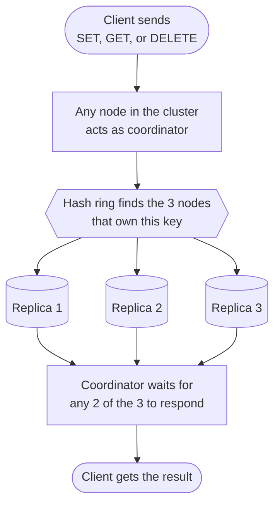
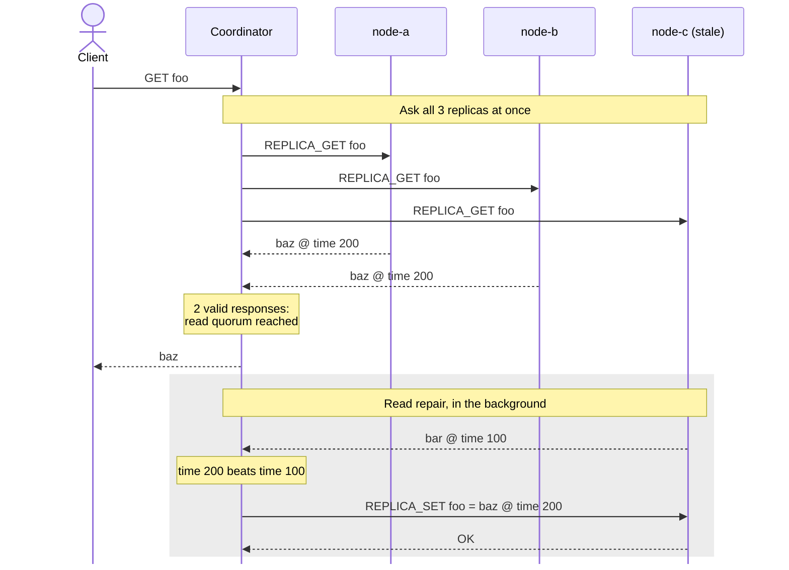
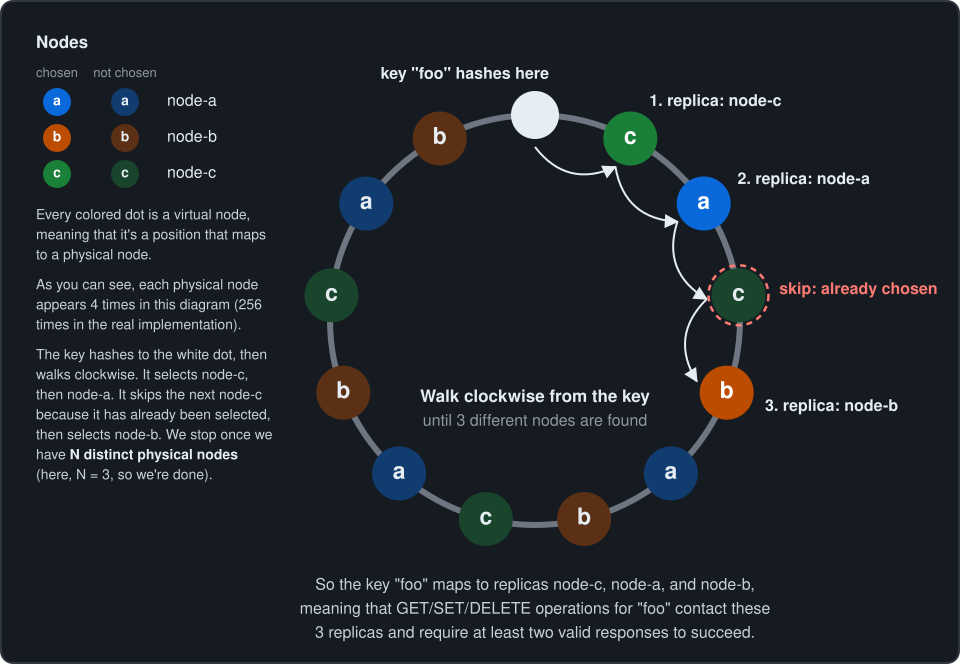

# Distributed Key-Value Store

An in-memory distributed key-value store in Go, served over TCP, with consistent
hashing, quorum replication, versioned records, tombstones, and read repair.



Every key is copied to 3 nodes (replicas), and a request only needs 2 of them to respond, so
the store keeps working when one of those nodes is down. 

For a detailed explanation of how these replicas are selected, see [Partitioning](#partitioning).

## Key Features

The store supports:

- concurrent TCP clients
- GET, SET, and DELETE commands
- consistent hashing with virtual nodes
- replication across 3 nodes
- read and write quorums
- versioned values
- tombstones for deletes
- connection pooling between nodes
- concurrent replica fanout
- network read and write deadlines
- asynchronous read repair after read quorum
- stale pooled-connection retry
- idle connection expiration
- separate client and replica TCP listeners
- client/replica protocol isolation

A client can connect to any node. That node will then act as the coordinator for the
request, so it will find the replicas responsible for the given key, and communicates with
the other nodes when needed.

The quorum configuration is:

    replication factor (N) = 3
    read quorum (R)        = 2
    write quorum (W)       = 2

With `R = 2`, `W = 2`, and `N = 3`, the system satisfies `R + W > N`. This ensures that every read quorum overlaps with every write quorum by at least one replica. However, concurrent writes and timestamp-based conflict resolution mean this does not guarantee strong consistency.

You can find more on this topic in [*Dynamo: Amazon’s Highly Available Key-value Store*](https://www.allthingsdistributed.com/files/amazon-dynamo-sosp2007.pdf) Chapter 4.5

## Design

The store is an in-memory `map[string]VersionedValue` guarded by a `sync.RWMutex`,
shared across all client connections.

Each stored record contains:

```go
type VersionedValue struct {
    Value     string      // the string itself being stored
    Version   Version    // the unique identifier by timestamp of when a transaction occured
    Tombstone bool      // specifically for deletions, see DELETES below
}
```

A version contains a timestamp and the ID of the node that coordinated the
write:

```go
type Version struct {
    Timestamp int64     // time.Now().UnixNano()
    NodeID    string   // example: node-a
}
```
The timestamp is used to identify the newest value during quorum reads. If two versions share the same timestamp, the node ID serves as a deterministic tie-breaker.

> **Note:** This approach relies on timestamps to determine which write occurred most recently, which can be unreliable due to clock skew between nodes. The node ID tie-breaker ensures deterministic ordering but does **NOT** guarantee correctness. A more reliable approach, such as [vector clocks](https://www.geeksforgeeks.org/computer-networks/vector-clocks-in-distributed-systems/), can track causal relationships between writes.


## Separation of client and replica listeners
Each node runs two TCP listeners.

The `client listener` accepts:

```text
SET key value    -> OK | error <reason>
GET key          -> value | NOT_FOUND | error <reason>
DELETE key       -> OK | error <reason>
<bad input>      -> parse error <reason>
```

`error <reason>` means the quorum could not be reached, for example when 2 of the
key's 3 replicas are down.

The `replica listener` accepts:

```text
REPLICA_SET key timestamp nodeID value
REPLICA_GET key
REPLICA_DELETE key timestamp nodeID
```

Commands sent to the wrong listener are rejected. A user/client can connect to the `client listener` of any node, and that node receiving the request becomes the coordinator.

> **NOTE**: Client commands do not contain replication metadata. The coordinator creates
the record version, then sends internal commands to the replica listeners of the
nodes selected by the hash ring.

Internal `GET` responses include one of these three stored versions:

```text
VALUE timestamp nodeID value
TOMBSTONE timestamp nodeID
NOT_FOUND
```

## Writes

For a `SET` request, the coordinator sends the write to all 3 replicas concurrently and returns success after at least 2 acknowledgements.

Example:
`SET foo bar`

```text
coordinator creates version X

node-a -> foo = bar @ version X
node-b -> foo = bar @ version X
node-c -> foo = bar @ version X
```

All replicas receive the same timestamp and coordinator node ID.

## Reads

For a `GET`, the coordinator sends reads to all 3 replicas concurrently.

Only responses that complete without a network/protocol error count toward the
read quorum. At least 2 valid responses are required

As soon as the coordinator has `R = 2` valid responses, it selects the newest
record from those responses and returns it to the client (remaining replica responses are still collected in the background)

After all remaining outcomes arrive, the coordinator selects the newest record
again from every valid response. If that final winner is newer than
what some replicas contain, those stale/missing replicas are repaired
asynchronously

**Note:** This means the client may receive a value from the first quorum, even if a slower
replica later has a newer version

If the winning record is a tombstone, the client receives `NOT_FOUND`.

Replicas that fail to return a valid read response are not repaired during that
request because their current state is unknown.

**Example:**

```text
node-a -> baz @ time 200
node-b -> baz @ time 200 

node-c -> bar @ time 100
```

`GET foo` returns `baz` because it has the newer version.

The client gets its answer as soon as 2 replicas respond. The repair of `node-c`
happens afterwards, without the client waiting for it:



> **Note:** A missing value and a tombstone are different. 
> 
> A missing key indicates that 
no record exists at all. 
> 
> A tombstone is a versioned record indicating that a key was deleted. 
Unlike a missing key, it preserves deletion metadata so that older versions can be recognized as stale.

While both return `NOT_FOUND` to client, the tombstone prevents an
older value from being restored later (zombie data).

## Deletes

`DELETE` does not physically remove the key from the store.

The coordinator creates a new versioned tombstone and replicates it using the
same write quorum as `SET`.

`DELETE foo`

```text
node-a -> tombstone @ version X
node-b -> tombstone @ version X
node-c -> tombstone @ version X
```

Keeping the tombstone allows replicas to distinguish an intentional delete from
a node that does not have the key.

`DELETE` returns `OK` whether or not the key exists. The coordinator does not read
before writing, so deleting a key that was never set still stores a tombstone on
its 3 replicas, and repeating a `DELETE` is safe. Writing the tombstone regardless
matters because a replica that missed earlier writes could still hold an old value.

For more, see this Wikipedia on the topic: [Tombstones](https://en.wikipedia.org/wiki/Tombstone_(data_store))

## Partitioning

Keys are assigned to nodes using consistent hashing with virtual nodes.

Each physical node is placed on the 64-bit hash ring at 256 virtual positions.
A key is assigned to the first node found clockwise from the key's hash.

For replication, the key is assigned to the first 3 unique physical nodes
found clockwise on the ring.



Because each node appears at many positions, the same node can come up twice
during the walk. Repeats are skipped so all 3 copies land on different nodes.

Consistent hashing keeps rebalancing proportional. Removing one of N nodes
remaps roughly 1/N of the keys instead of remapping almost everything as
`hash(key) % N` would.

## Connection Pooling

Nodes reuse TCP connections when communicating with peers.

The pool keeps a bounded set of idle connections for each peer. A request
borrows one connection, sends one command, reads one response, and returns the
connection only if the operation completed successfully.

If the borrowed connection fails, it is closed and the request is retried once
using a guaranteed fresh connection.

Each pooled connection records when it became idle. Connections idle longer than
30 seconds are closed and discarded when the pool next examines them.

If no reusable connection remains, the pool opens a fresh TCP connection.

## Layout

    cmd/kvstore/         server entry point

    config/              shared cluster configuration
    docker/              Dockerfile and Compose configuration

    internal/cluster/    cluster membership and replica lookup
    internal/server/     TCP server, protocol parser, quorum coordination
    internal/store/      versioned in-memory key-value store
    internal/hashring/   consistent hashing ring

    benchmarks/          distribution measurement script
    decisions/           architecture decision records
    assets/              images

## Cluster Configuration

All nodes load the same cluster definition from `config/cluster.yaml`.

Example:

```text
client_listen_address: ":8080"
replica_listen_address: ":9090"

nodes:
  - id: 3fb21a70-0b5b-47b3-beb4-dc9588889d71
    replica_address: node-a:9090
  - id: b31558ec-23ec-4be8-92c2-df30efc6dadc
    replica_address: node-b:9090
  - id: 8e91e2ff-b054-49ad-b0e9-5dc2ee5df23b
    replica_address: node-c:9090
  # ...node-d through node-h
```

Each node's `id` is a UUID. It determines where the node sits on the hash ring.

`client_listen_address` is the local address used for client commands.

`replica_listen_address` is the local address used for internal replica commands.

Each node's `replica_address` is the Docker network address that other nodes use to
reach it.

## Decisions

- [001: Virtual nodes and FNV-1a prefix ordering](decisions/001-virtual-nodes.md)
- [002: Connection pool for forwarding](decisions/002-connection-pool.md)
- [003: Quorum semantics](decisions/003-quorum-semantics.md)
- [004: Separate client and replica protocol listeners](decisions/004-separate-client-replica-listeners.md)
- [005: Synchronous read repair after all replica responses](decisions/005-synchronous-read-repair.md)
- [006: Asynchronous Read Repair After Read Quorum](decisions/006-asynchronous-read-repair.md)

## Running the tests

```bash
go test ./...                      # all packages
go test -race ./...                # with the race detector
go test -v ./internal/hashring/    # includes rebalance move percentages
```

## Distribution benchmark

```bash
go run ./benchmarks/distribution.go
```

## Running an Eight-Node Cluster

The cluster uses one shared configuration file and one Docker image. Docker Compose starts eight instances of the same server with different node IDs.

To start, run:

```bash
docker compose -f docker/compose.yaml up --build
```

The client port mappings are:

```text
localhost:8080 -> node-a client listener
localhost:8081 -> node-b client listener
localhost:8082 -> node-c client listener
localhost:8083 -> node-d client listener
localhost:8084 -> node-e client listener
localhost:8085 -> node-f client listener
localhost:8086 -> node-g client listener
localhost:8087 -> node-h client listener
```
All eight nodes listen for client commands on `port 8080` inside their own
containers.

Each node also listens for internal replica commands on `port 9090`. These replica ports are available only inside the Docker Compose network and are not published to the host.

Once the servers are running, connect to a server:

```bash
nc localhost 8080 # node-a
```

Any other node works the same way:

```bash
nc localhost 8081 # node-b
nc localhost 8087 # node-h
```

Example commands:

```text
SET foo bar
GET foo
DELETE foo
GET foo
```

### Running in the background

Use detached mode to start the cluster without keeping the logs attached to the current terminal.

```bash
docker compose -f docker/compose.yaml up --build -d
```

View logs from the full cluster:

```bash
docker compose -f docker/compose.yaml logs -f
```

View logs from one node:

```bash
docker compose -f docker/compose.yaml logs -f node-a
```

Stop and remove the cluster containers:

```bash
docker compose -f docker/compose.yaml down
```

The store is currently in memory, so stopping the containers removes all stored records.
